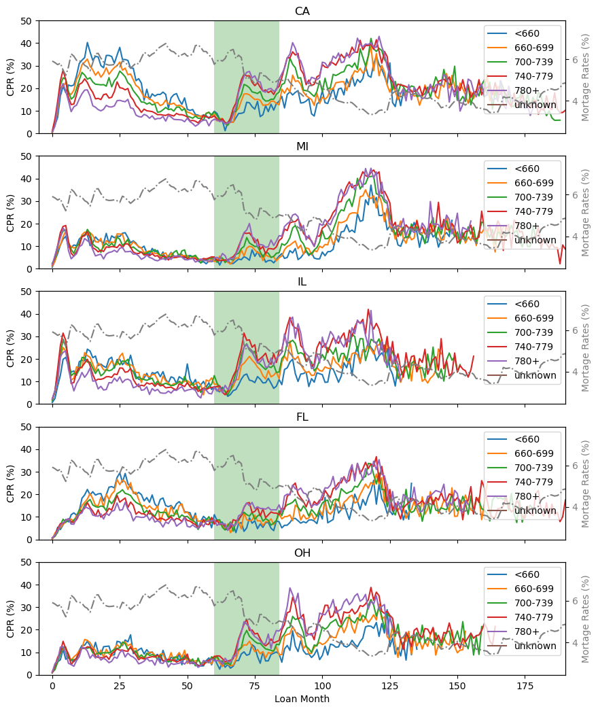
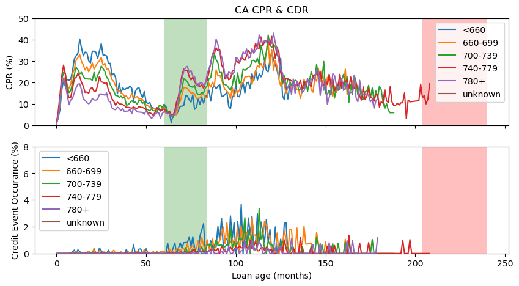
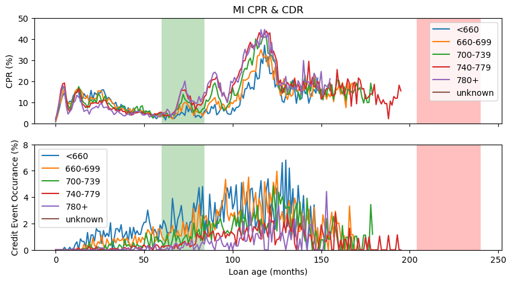
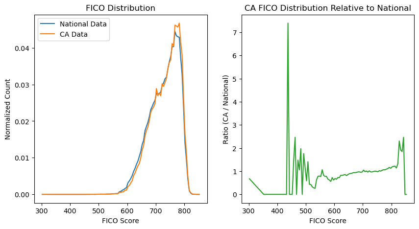
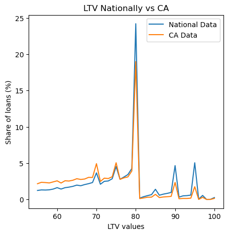
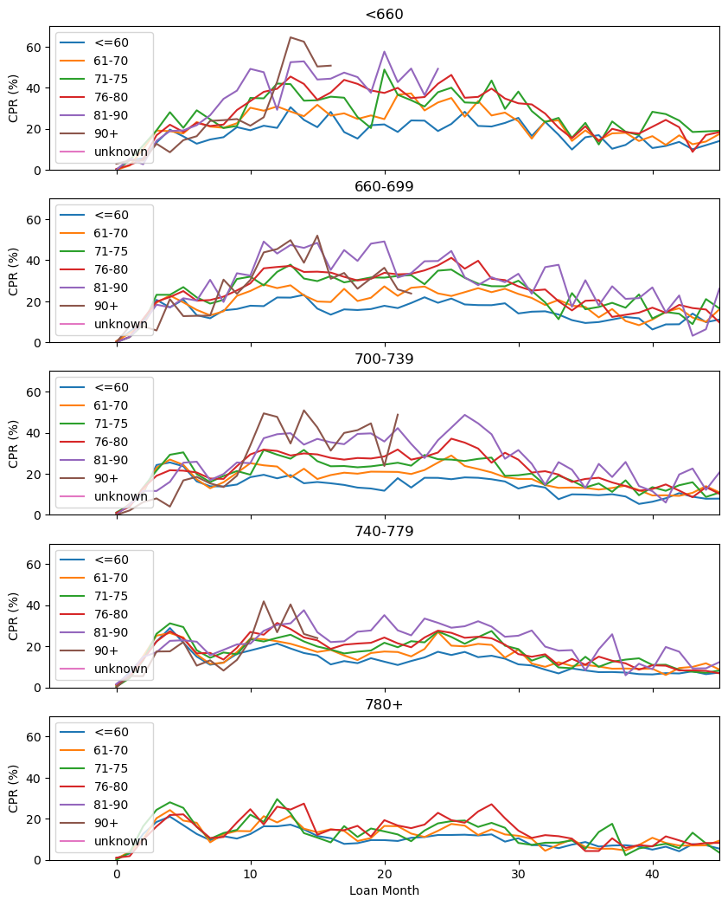
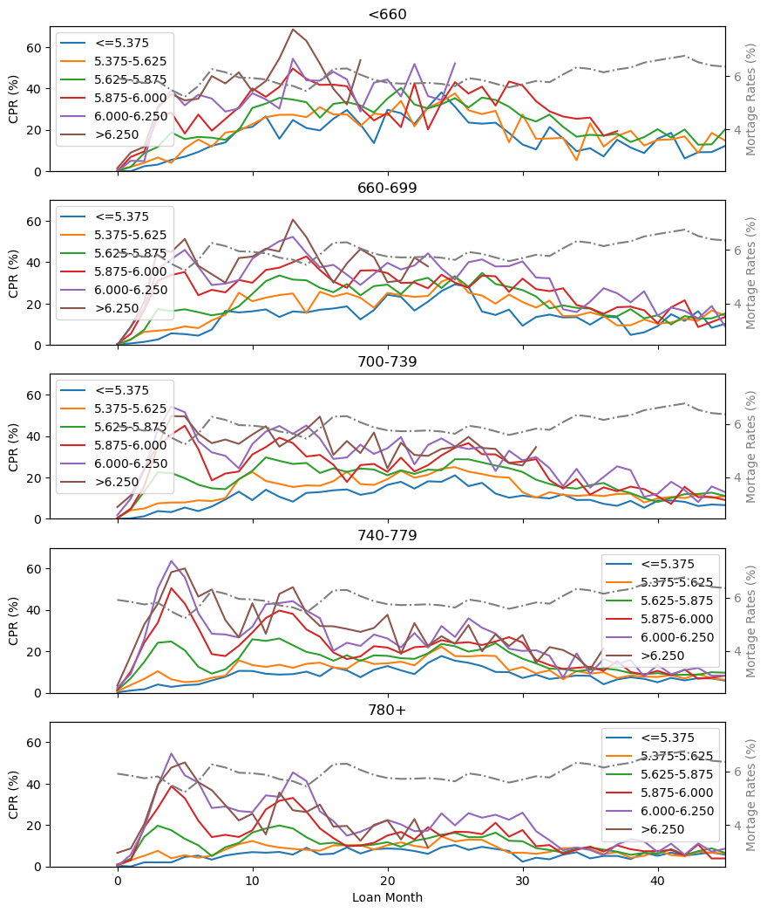
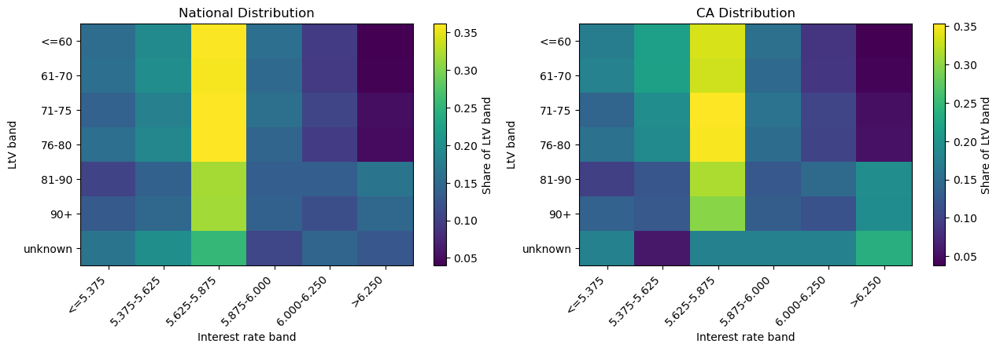
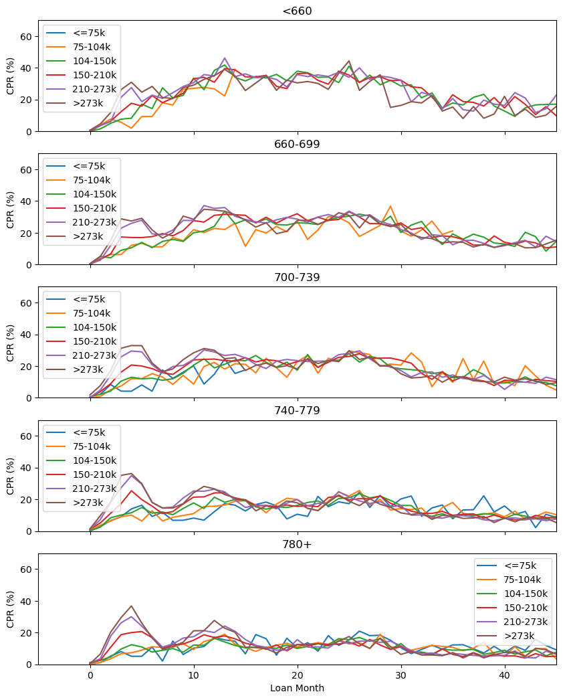

# freddie_prepayment
Simple analysis of home loan payment records and prepayment records

Prepayment and termination analysis of 2003 vintage from Freddie Mac's Single-
Family Loan dataset, using PostgreSQL for data management and Python for 
modeling.

## Data
Data for this mini-project are downloaded from Freddie Mac via the following:
https://www.freddiemac.com/research/datasets/sf-loanlevel-dataset

Data used to build the analysis:\
Standard Dataset, Release 47 (July 2026 layout), vintage 2003Q1-Q2\
** Within the file structure 2003Q3-Q4 are also present, but not used in analysis 
currently. Later expansion might be added, though storage is limited **

The raw data used is not included in this repository to comply with Freddie Mac's terms 
(non-commercial, research use permited, but license required for redistribution). Please
download the necessary files in 'data/raw/'. 

Field definitions, termination codes, and sentinel value handling are documented 
in [DATA_NOTES.md](DATA_NOTES.md).

## Setup
1. Create the database:
       createdb freddie
2. Build the tables and cleaning views:
       psql -d freddie -f sql/01_schema.sql
3. Load the data. In psql, from the project root:

       \copy orig FROM 'data/raw/orig_2003Q1.txt' WITH (FORMAT csv, DELIMITER '|', QUOTE E'\b', NULL '')
       \copy perf FROM 'data/raw/perf_2003Q1.txt' WITH (FORMAT csv, DELIMITER '|', QUOTE E'\b', NULL '')

   Repeat per vintage, then add keys:

       ALTER TABLE orig ADD PRIMARY KEY (loan_id);
       ALTER TABLE perf ADD PRIMARY KEY (loan_id, period_ym);
       ANALYZE orig;
       ANALYZE perf;

4. Build the remaining views and aggregates:

       psql -d freddie -f sql/03_build_prepay_aggregate.sql
       psql -d freddie -f sql/04_freddie_build_extra_agg.sql

5. *Optional* build the following tables and views:

       psql -d freddie -f sql/00_reference_tables.sql
       psql -d freddie -f sql/02_freddie_views.sql

    03 and 04 builds are essential for subsequent analysis. 00 and 02 builds tables/views that would 
    be useful for potentially additional analysis, but are not currently used in this project. 

## Methods
1. CPR calculation - I utilized a loan-count CPR rather than balance-weighted, because the loan-count values are 
readily available calculation that is cleaner, more condusive to this learning excercise, and significantly less 
expensive in terms of computation resources. NOTE: for SMM, it is important to keep counts of exposure and 
prepayments, and do the division for the SMM once the summation for various bands is completed, and not sum the SMM. 

2. Because of the grain size I selected, especially when analyzing individual states, certain loan month meeting
various criteria may have small exposure sizes that induce small number statistics. Whenever possible, I try to 
the exposure floor at 1000 to avoid that problem. However, in certain cases, I lower that to 500 to get data to 
look for patterns, and thus a more encompassing picture of what is happening.

3. Various band boundaries and their selection: 
       - FICO: 660, 700, 740, 780, based on industry conventions, and with initial cutoff at 660 to separate out the
       subprime lenders. 
       - LTV: used 60, 70, 75, 80, and 90 as the cutoff values. Based on spikes in the datawhere larger number of loans
       have those LTV's. Verified both nationally and for a few individual states (with higher proportions of loans, see
       analysis/01_analysis.ipynb)
       - Original UPB and interest rates: these were selected based on the 10, 25, 50, 75, and 90th percentiles 
       nationally, to allow the same cutoffs and value-based comparison

## Findings

### Summary

Analysis of 2.1M loans originated in 2003Q1–Q2, tracked monthly through 2025 (~200M loan-months), using PostgreSQL for 
aggregation and Python for analysis.

**1. Prepayment is driven by rate environment, not loan seasoning.** The CPR curve
for a single vintage shows several distinct surges (early 2003–04, 2009–10, a 
large hump through 2011–13, and 2021) separated by a trough during the 2008 credit
crunch. This pattern does not resemble a smooth seasoning ramp. Because a single vintage
confounds loan age with calendar date, the curve instead represents a neat record of
the behavior of mortage rates through one cohort.


CPR and CDR over loan months, with green and red regions representing approximate time 
of 2008 and 2020 financial crisis, respectively. Plotted in gray is the average mortgage 
rates over the same time, showing an inverse relationship to the CPR.

**2. The credit gradient reverses between the two major refinancing waves.** In
California's 2005 spike, the lowest-FICO band prepaid *fastest*, inverting the
usual pattern; in the 2011–13 wave, the highest-FICO bands lead. Rates were
flucuating, but relatively steady, so it cannot be rate refinancing. Similar behavior
can be observed in Florida, albeit less prominent, and even less in other states. 



CPR for the 5 largest represented states in this dataset, divided into different FICO bands. 
The states are ordered from top to bottom in their percentage represented in this dataset.

**3. California and Michigan diverge sharply in CPR and CDR.**
During loan age 13–25, CA peaks near 40% CPR with a strong FICO gradient, while MI tops
out near 20% with the bands nearly overlapping. Michigan's CDR runs roughly double California's 
and begins rising around or prior to 2008 (depending on FICO band).


CPR and CDR for California. Note the early spikes in CPR on top.


CPR and CDR for Michigan. Note the much higher CDR rates, especially prominent 
following 2008, while CPR reaches similar heights as California.

**4. Composition does not necessarily explain the differences.** California's FICO distribution
is close to national (roughly 1, ignoring small number statistics at lower ends below 500), 
and its LTV distribution is skewed *lower*, not higher — the 90 and 95 LTV clusters are a
quarter to a third of their national share. Whatever drives the California spike in CPR
is not simply due to a riskier pool.


Distribution of FICO scores nationally and in CA, and a comparison.


Distribution of LTV scores nationally and in CA.

**5. Credit events lag defaults by 3–4 years.** Terminations coded as short sale or
REO disposition peak at loan ages 110–140 (2012–2014), well after the 2009–10
delinquency peak — the foreclosure pipeline, extended by the 2010–12 foreclosure
moratoria.

### Details

When examining the 30 year loans, the CPR is closely tied to the inverse of the national average mortage 
rates instead of the age of the loans. The national CPR had two spikes, one tied to the rate dops following 
2008, and one tied to the rate drops early in the 2020 COVID response. While I am not sure how surprising 
this conclusion is, it does help to demonstrate that the 2008 financial crisis provided some opportunities 
for home buyers who were prepared, and for financial institutes, further risks beyond the crisis itself. 

An interesting aspected that I noticed was the heightened CPR early on in the loan ages. These high CPR 
appear to be dominated by lower FICO score borrowers, and dominated by California loans. In fact, I first 
spotted this pattern when looking at the California data, and where the peaks rivaled that of the later 
heights following the 2008 events, and only then noticed this on the national data. Upon this, I looked at
a few more states, and only discovered similar patterns in Florida, and slightly in Illinois. This is not 
entirely explained by differences in loan composition, such as different distributions of FICO scores or LTV. 

I am not entirely able to decipher why this pattern occurs, and can only hazard a guess. Given this is 
happening in California, and to some extent in Florida, this could be related to rising house prices in these
regions. Based on my previous knowledge, this time period saw significant increase in home prices in both 
of these states, though for slightly different reasons. With the increased upderlying prices, recent home 
buyers are able to secure better loans and rates and refinance their recent purchase. Since these are price
increases following the initial loan, this does not influence the initial LTV distribution. However, when 
looking at CPR divided by both FICO and LTV, we see that the highest CPR during this period are for low FICO 
scores, and high LTV. To my (not too expert) eyes, this means that these refinanced loans are dominated by 
buyers who had to finance a larger portion of their purchase, but did not have great FICO scores. As home prices
increased (and likely their FICO scores increased), they are able to get better financing options, and took that
opportunity. How soon that occurs, as someone who has never bought a house, I don't have a great idea. But this
is currently my working hypothesis. 


CPR for California loans, divided by FICO and LTV bands. Note that the higher LTV bands had higher CPR through
this period, which only covers months prior to 2008. 

This appears to make make sense with the interest band information as well. Those with higher interest tend
to be more likely to refinance, and as shown below the higher interest borrowers financed the most in this
period. It also does appear that CA has more higher LTV loans with high interest, though the statistical 
significance of this would require further investigation. 


CPR for California loans, divided by FICO and interest rate bands. 


Distribution of interest rates across different LTV bands for loans nationally and in CA.

I took some further looks into the UPB bands, and the CPR stays very consistent across the different bands, 
indicating to me that the loan amount is not a factor. One possible problem here is that the bands are determined
using national values, not California values, but even so there should be some noticeable differences if it is a
significant factor. 


CPR for California loans, divided by individual FICO and UPB bands.

Overall, it would appear that the prepayment history of loans from the early 2000's are dominated by the financial
opportunities borrowers experienced if they survived the major financial events in 2008, and less extent 2020. By
the time the 2020 COVID events took place, most of the borrowers are likely well established financially, and thus
would be unlikely to either need refinance or have a credit event. However, following 2008, there were definitely 
higher levels of credit events, especially noticeable in states like Michigan, where things are likely exasterbated 
by the problems the automobile industry experienced. However, for financial institutions, these events would appear 
to present a double-whammy, first the initial problems that that the financial crisis creates, followed by the 
refinancing that hurt the longer term abilities of the institutes. Of course, this is a rather simplified overview
from someone who is a newcommer to this discipline, and I would welcome any feedback from more experienced 
researchers into this topic. 

Originally when picking this pack of loan vintage, I had expected to see more prominently the effects of the 
2008 Financial Crisis. As a first time foray into this topic, I thought that this vintage would provide some
more standard patterns, but close enough to the crisis to be really strongly affected by the events in 2008. 
While there are definitely patterns tied to the Financial crisis, it appears more related to the mortage 
rates changes in response to 2008, rather than the event itself. Of course, there is also significant delays
in the processing of foreclosures and such that are beyond the scope of this project, and that I had not 
initially realized, delaying the peaks of the CDR beyond 2009. Much of my hypothesis stated in the above are 
based on rather basic history and understandings of the financial system and financial incentives of home buyers
and financial institutes, and of the events that unfolded in the past few decades. For much of these events, while 
I did live through them, I was not always aware of the full implications and impacts. Here, I am just presenting 
some simple analysis and hypothesis, but will welcome any suggestions on further research that might prove 
insightful. 


## Repository Layout
```bash
├── DATA_NOTES.md
├── README.md
├── analysis
├── data
│   ├── file_headers_july_2026
│   │   ├── origination_data_file_header.txt
│   │   └── performance_data_file_header.txt
│   ├── raw
│   │   └── historical_data_2003
│   │       ├── historical_data_2003Q1
│   │       │   ├── orig_2003Q1.txt
│   │       │   └── perf_2003Q1.txt
│   │       ├── historical_data_2003Q2
│   │       │   ├── orig_2003Q2.txt
│   │       │   └── perf_2003Q2.txt
│   │       ├── historical_data_2003Q3
│   │       │   ├── orig_2003Q3.txt
│   │       │   └── perf_2003Q3.txt
│   │       └── historical_data_2003Q4
│   │           ├── orig_2003Q4.txt
│   │           └── perf_2003Q4.txt
│   └── release-47-sample-files
│       └── Sample Files
│           ├── origination_sample_file.txt
│           ├── performance_sample_file.txt
│           └── scp46436
├── images
├── disclosure-changes-summary.pdf
├── file_layout_july_2026.xlsx
├── general_user_guide_july_2026.pdf
├── outputs
└── sql
    ├── 01_freddie_schema.sql
    └── 02_freddie_views.sql
```
